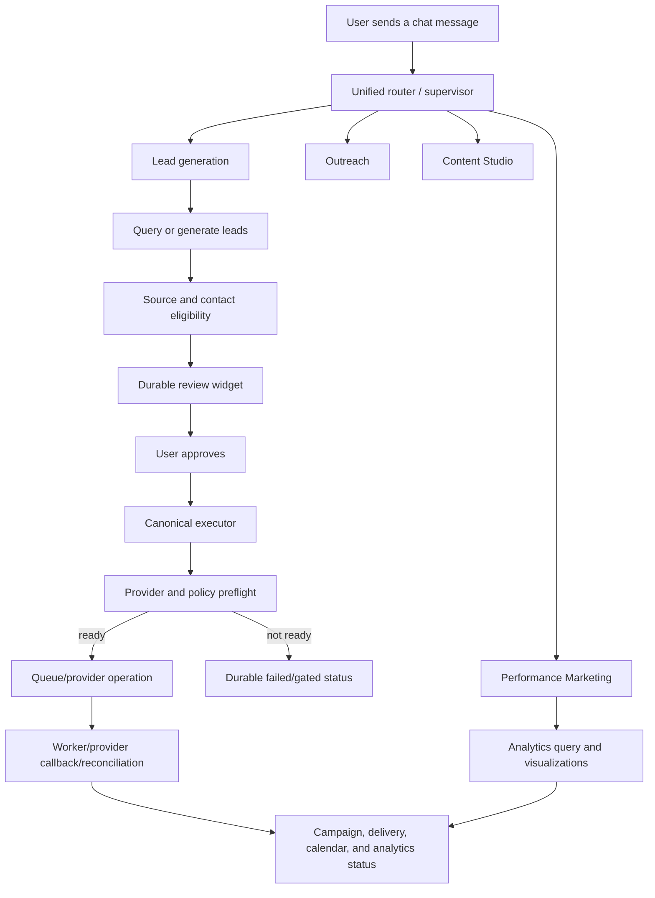

# Chat Campaign Use-Case Acceptance QA

> Current status: see **Follow-up implementation matrix — 2026-09-22** at the end. Historical failures below are retained for reproducibility. Local implementation fixes are not a production provider-success signoff.

Date: 2026-09-20\
Environment: local development API on `localhost:8090` and client on `localhost:3000`\
Scope: multi-message chat flows for lead review, bulk outreach, content scheduling/publishing, ad generation/publishing, and analytics.

## Executive result

The application has the core workflow pieces, but the full set of requested use cases is not fully signed off.

What works:

- A chat can retrieve owned leads and identify email/phone eligibility.
- Outreach can create durable review cards containing exact lead IDs for email and WhatsApp.
- Submitting an outreach review is provider-gated and records a terminal failure without sending when credentials are absent.
- Chat can resolve a saved social asset and create a scheduled-publishing review with an exact timestamp.
- Ad creative generation can save a compliant ad asset when the account has an approved, non-placeholder website.
- Analytics can return campaign metrics and visualization data after the analytics review is confirmed.
- REST status surfaces return campaign dashboard, trend, outreach, and calendar data.

What is not fully working:

1. Yelp is shown in the client vocabulary, but there is no backend Yelp extraction workflow/catalog entry.
2. Natural multi-turn routing can send an outreach or performance request back to ICP/Content Studio instead of the requested specialist.
3. Some assistant replies contradict durable widget state. In the live test, the assistant said there were no pending cards while active analytics/ad widgets existed, and it called an email-template widget an email-outreach widget.
4. The direct switch-agent route has a request-contract mismatch: its validator expects `agentType`, while its handler requires `targetAgent`.
5. A request for three ad-copy variations produced a one-variation generation widget and one saved asset.
6. Publishing remains dependent on valid provider accounts and a server-issued ad review revision. That safety gate worked, but a real provider-success canary was not possible with the synthetic account.
7. One existing client UI contract failed because Social Insights tab markup no longer matches the test's expected literal. This is test-contract drift, not proof that the underlying analytics API is broken.

No external email, WhatsApp message, social post, ad publication, campaign activation, pause, or budget spend was performed. The test account had no email credentials, no WhatsApp official-provider binding, an unavailable/expired synthetic Instagram account, and paid-ad live mutations disabled.

## Intended conversation flow

The important boundary is that creating a review card is not sending, publishing, or spending. The durable widget status and execution result are the source of truth after approval.

## Live multi-message tests

The live tests used synthetic account user `24` and these chat threads:

| Thread | Scenario | Fixture |
|---:|---|---|
| 218 | Lead review and outreach | Five synthetic leads, approved ICP revision 1 |
| 219 | Saved social asset scheduling | Social asset `169` |
| 220 | Paid ads and analytics | Paid campaigns `17`, `18`, `19`; synthetic metrics |

### 1. Lead review and bulk outreach

Seeded leads:

| ID | Source/platform | Email | Phone |
|---:|---|---|---|
| 1230 | LinkedIn | yes | yes |
| 1231 | Google Maps | no | yes |
| 1232 | Yelp | yes | no |
| 1233 | Instagram | no | yes |
| 1234 | Google Maps | yes | yes |

Message sequence:

1. `Review every lead found for this campaign, grouped by source (LinkedIn, Instagram, Google Maps, and Yelp). Show which leads have an email address, which have a phone number, and do not send anything.`
2. `Using only the reviewed campaign leads, prepare an email outreach campaign for every lead that has an email address. Draft the subject and body and show the exact recipient count for review. Do not send.`
3. `Also prepare a WhatsApp outreach campaign for every lead that has a phone number. Show the exact recipient count and any exclusions for review. Do not send.`
4. `What actions are currently waiting for my approval, and confirm that no email or WhatsApp message has been sent?`

Observed result:

- Message 1 retrieved all five records, reporting 3 emails and 4 phone numbers.
- The first continuation was routed to ICP generation instead of Outreach because the ICP was not approved.
- After generating and approving ICP `168` revision `1`, and explicitly selecting Outreach, the system created:
  - Email review widget `62`, tool `send_outreach_messages`, lead IDs `[1230, 1232, 1234]`.
  - WhatsApp review widget `61`, tool `send_outreach_messages`, lead IDs `[1234, 1233, 1231, 1230]`.
- The email widget was submitted and ended `failed` with: `No email credentials configured. Please connect Gmail OAuth or Resend...`.
- The WhatsApp widget was submitted and ended `failed` with provider gate `OFFICIAL_PROVIDER_NOT_READY`; it was marked retry-safe.
- `/api/outreach/campaigns` remained at zero campaigns and `/api/outreach/stats` remained at zero sent/delivered/opened/replied messages.
- No external side effect occurred.

Important routing/status defect in the same sequence:

- The natural email request first created widget `60` with tool `generate_email_template`, not an outreach send widget. The later assistant summary incorrectly described widget `60` as “Email Outreach” for three recipients, even though its durable form values contained no lead IDs and its tool was `generate_email_template`.
- An explicit Outreach request with exact lead IDs produced the correct widget `62`. This means the underlying tool works, but the natural-language handoff is not reliable enough for unattended campaign use.

### 2. Content lookup, scheduling, and publish boundary

Seeded asset `169`:

- Type: `social_post`
- Channel: Instagram
- Status: `draft`
- Content: synthetic QA launch copy

Message sequence:

1. `Content Studio: show the saved social post asset 169, its exact platform and current status. Do not publish or schedule it.`
2. `Schedule saved asset 169 for Instagram at 2030-01-15T10:00:00.000Z. Show the review card and do not execute or publish it yet.`
3. `What content publishing or scheduling action is waiting for my approval, and confirm the asset has not been published?`

Observed result:

- Asset lookup correctly returned asset `169` as an Instagram draft.
- The scheduling request created widget `63`, tool `publish_social_post`, with asset `169`, Instagram target, and the requested future timestamp.
- Submitting widget `63` ended `failed` with `The selected instagram account is unavailable or expired.`
- No provider post was created and the asset was not externally published.
- The final chat status response did not clearly surface the still-active review card, which is another example of conversational state lagging durable widget state.

Conclusion: chat scheduling/review is present; end-to-end scheduled publishing needs a valid connected account and a provider callback/worker canary.

### 3. Paid ad generation, launch review, and analytics

Message sequence on thread `220` included:

1. `Read-only performance analysis: analyze all saved paid campaigns and show spend, impressions, clicks, CTR, CPC, CPA, conversions, ROAS, trends, and recommendations. Do not change, pause, publish, or spend anything.`
2. `Generate three ad-copy variations for the Google Demo Leads campaign, save them for review only, and do not publish or spend.`
3. `Prepare a Meta and Google campaign launch review using the saved campaigns. Show exactly what would be published and confirm that it will not publish or spend until I approve.`
4. `What review actions are pending, and confirm that no provider mutation, ad publication, or budget spend has happened?`

Observed result:

- The analytics request created widget `64`, tool `analytics_query`, instead of returning the read-only result immediately. After confirmation, widget `64` succeeded and returned three campaign rows plus bar/line visualization data.
- The assistant later said there were no pending review cards while widget `64` was active before confirmation. The durable widget endpoint was correct; the conversational summary was not.
- The three-variation request produced generation widget `66` with `auto_generate_image: false`, but the first submission was safely blocked because the business profile had no approved website.
- After adding a synthetic non-placeholder approved website to the test fixture, the generation request succeeded as widget `68`, saving ad asset `170`. The result contained one variation (`totalVariations: 1`), so the requested count of three was not honored.
- The ad launch request eventually produced widget `69` for Meta campaign `17`. The separate ad-review endpoint returned a server-issued revision and explicit validation errors: missing landing page URL, invalid/empty country code, no platform-ready creative, no selected Meta account/Page, and no saved Meta provider settings.
- After the review revision was supplied, submission of widget `69` ended `failed` with a provider mutation gate: `Live provider mutations are gated.` No campaign was activated and no spend occurred.
- A separate earlier launch widget (`65`) was created for Google campaign `18` even though the preceding natural-language request referenced Meta campaign `17`; this is another cross-turn request/summary mismatch.

The approved test website was restored to its original `null` value after the generation acceptance test.

### 4. Analytics and graphical data

The successful analytics widget returned:

- 3 campaigns with measured data
- 392 conversions
- 3.12% average CTR in the chat analytics result
- Bar visualization: spend by campaign
- Line visualization: CTR trend
- Campaign classifications: high/measured/low

The REST dashboard also returned:

- 3 campaigns, 2 active and 1 paused
- Daily trend points with impressions, clicks, spend, reach, and conversions
- Campaign-level spend/click/conversion/CTR/CPC/CPM metrics
- Status distribution and AI policy settings

Data-quality issue: the chat analytics summary rendered the total spend with a dollar sign (`$47,820.08`) even though the seeded campaigns and REST dashboard currency are INR. The analytics contract needs one authoritative currency formatter.

## Lead-source coverage

The lead data model has source/platform fields for social sources, Google Maps, phone, email, and Yelp-like records. However:

- `listWorkflowsForChannels(['linkedin', 'google_maps', 'yelp'])` returned workflow strategies for LinkedIn and Google Maps, but an empty list for Yelp.
- `query_leads`'s platform filter schema does not include `yelp`.
- Prompt/template guidance explicitly names LinkedIn, Google Maps, Justdial, Instagram, Facebook, and Twitter but omits Yelp.
- The UI lists Yelp, so the product currently advertises a source that the backend cannot extract through the normal lead-generation workflow.
- The live unfiltered query could still display a manually seeded Yelp row; that proves storage/display, not Yelp extraction support.
- The live tool output normalized platform values to `profile`/`place` instead of consistently preserving `linkedin`/`instagram`/`yelp`/`google_maps`. Source grouping and attribution should use one canonical enum.

## Automated test results

Server acceptance contracts:

- 25 suites passed
- 247 tests passed
- Covered widget registry, outreach queue/provider outcomes/delivery persistence/progress, content publishing/scheduling contracts, ad review/provider safety, analytics, social insights, and lead contracts.

Client contracts:

- 10 suites passed
- 65 tests passed
- Covered outreach UI, content calendar timing, publish widgets/dialogs, ad publishing, performance analytics, social insights, and publishing receipts.

One additional existing client suite failed:

- `client/src/__tests__/adPerformanceUiContract.test.ts`
- 16 tests in the suite, 1 failed
- Failure: the test expected literal tab markup `>Overview</TabsTrigger>` but the current Social Insights component renders the tab label through a different expression.

This is a UI test/implementation contract mismatch that should be reconciled before calling the analytics UI green.

During the live local client session, Next/Turbopack also emitted an internal HMR panic while writing the `engagement-inbox` endpoint. The API remained usable and the focused client tests were able to run with the bundled Node 24 runtime, so this was not counted as a chat-domain failure. It should still be investigated before relying on the development server for browser acceptance runs.

## REST/status checks

Authenticated read-only checks returned HTTP 200 for:

- `/api/campaigns/analytics/dashboard`
- `/api/campaigns/analytics/17`
- `/api/campaigns/analytics/17/trends`
- `/api/campaigns/analytics/17/hooks`
- `/api/campaigns/analytics/18`
- `/api/outreach/stats`
- `/api/outreach/campaigns`
- `/api/content/calendar`

The REST surfaces expose useful persisted status, metric, trend, and timeline data. They should remain the authoritative source used by chat summaries after any widget or provider operation.

## Priority fixes

### P0 — conversation correctness

1. Make routing state-aware after a successful lead review. A request to prepare outreach should transition to Outreach or ask for a clear handoff, not silently route to ICP or Content Studio.
2. Fix the switch-agent route contract. Either accept `targetAgent` in the schema or change the handler to use `agentType`; keep the chat action route and direct route consistent.
3. Ground every “pending/no pending/sent/not sent” statement in fresh durable widget/campaign queries. Never relabel one tool's widget as another tool's widget.
4. Preserve canonical lead source/platform values in `query_leads` and add Yelp support end to end, or remove Yelp from the selectable source list until it exists.

### P1 — execution completeness

5. Make the chat publish flow explicitly call/submit the ad-review preparation step and show the revision/validation errors before exposing final approval.
6. Add a real provider canary for each configured channel: Gmail/Resend, WhatsApp Business, Instagram/Facebook/YouTube, Meta Ads, and Google Ads. Verify accepted, queued, delivered/provider-confirmed, failed, and retry states with idempotency.
7. Honor requested ad variation counts and expose the count in the generation widget schema.
8. Use one currency-aware formatter for analytics summaries and charts.

### P2 — UI and reporting

9. Reconcile the Social Insights tab implementation with `adPerformanceUiContract.test.ts`.
10. Show durable review widgets and terminal execution receipts inline in the conversation, with links to the corresponding Outreach, Content Calendar, Ads, or Analytics tabs.
11. Keep “stored/local status” versus “live provider status” visibly distinct in both chat and dashboard responses.

## Acceptance decision

The architecture is capable of the requested workflow, and the approval/provider-safety boundaries behave correctly. The application is not yet ready to claim that every requested chat use case works properly in production because Yelp extraction, natural multi-turn handoff correctness, durable-status grounding, ad variation count, and live provider delivery/publishing still need the fixes and canaries above.

## Remediation addendum — 2026-09-22

This addendum supersedes the unresolved implementation items above.

### P0 conversation correctness

1. Explicit email/WhatsApp/SMS recipient-campaign requests now route to Outreach even when they include subject/body copy or “do not send.” Standalone copy-only requests remain in Content Studio.
2. The direct switch route and handler now share the `targetAgent` request contract.
3. Approval/status questions are answered from a fresh account-scoped widget query. The response lists exact review IDs, tools, owners, channels, local states, sanitized errors, and outreach states correlated to the owned conversation/review, campaign/job and provider receipt. Recipient IDs alone are insufficient and fail closed. It does not infer provider delivery from widget success.
4. Lead queries preserve canonical platform provenance from `platformType` or `source`. Yelp is now present in router/query/ICP/settings schemas, has a discoverable `yelp` workflow, a reviewed actor input schema for `datascrapers/yelp-scraper`, capped mutually exclusive search modes, canonical lead mappings, and an ICP UI selection. The provider actor remains explicitly labeled paid and not live-verified for this account.

### P1 execution completeness

5. The saved-ad review endpoint and widget contract were reverified: final approval remains unavailable until the server returns a review revision and validation errors are resolved. Vague references to multiple saved campaigns now fail closed instead of silently selecting one; an explicit campaign ID in the latest turn overrides stale history.
6. The non-mutating provider canary now covers Gmail, Resend, WhatsApp, Facebook, Instagram, YouTube, Meta Ads, and Google Ads. It requires account binding plus two explicit execution interlocks and performs identity/scope/status checks only; it never sends, publishes, uploads, activates, or spends. Actual provider delivery/publication lifecycle signoff still requires configured test accounts and a separately authorized canary operation.
7. Ad generation accepts and persists an exact `number_of_variations` from 1–5, exposes the count in the widget, rejects a generator result with a different count, and deterministically preserves explicit counts from the latest user turn.
8. Analytics output carries each campaign's currency, does not sum unlike currencies, includes currency in chart data, and labels local/last-recorded status as not live-provider-verified.

### P2 UI and reporting

9. The Social Insights contract now tests the current tab, report, listening, and scheduling components; the focused suite passes.
10. Inline review cards now show owner, review ID, local status, sanitized terminal errors, and links to Outreach, Content Calendar, Ads, or Analytics.
11. Chat and widget copy now distinguishes local completion/stored rows from provider delivery, publication, activation, and spend.

### Verification

- Server focused acceptance: **21 suites passed, 188 tests passed, 8 database-dependent tests skipped**.
- Client focused acceptance: **5 suites passed, 32 tests passed**.
- Client TypeScript check: passed.
- Full client test inventory during this run: **1,283 passed, 1 unrelated existing source-literal test failed** (`platformAccessRecovery.test.ts` expects a hard-coded brand title while the component uses `BRAND_NAME`).
- Server TypeScript reached only pre-existing unrelated errors in Content Calendar, AI Visibility, and older test typings; none were in the changed campaign/orchestrator files.
- Focused lint had no errors in the new remediation files. The existing `adsExecutor.ts` still reports two unrelated unused constants.

No external email, WhatsApp message, social post, ad publication, campaign activation, pause, or budget spend was executed during remediation. Production provider-success cannot be claimed until the operator supplies dedicated provider test accounts/recipients and explicitly runs the gated canary.

## Follow-up implementation matrix — 2026-09-22

| Priority / original task | Implemented behavior | Remaining acceptance boundary |
|---|---|---|
| P0.1 — natural cross-agent handoffs | Recipient preparation routes to Outreach; copy-only and explanatory requests remain distinct. Negative send clauses cannot turn content requests into outreach. Intentional team pipelines survive corrections; leading `@` handles address specialists. Read-only Outreach queries work without selected recipients. | Live language-model routing is nondeterministic; automated regressions cover the reported prompts, not all possible paraphrases. |
| P0.2 — direct switch contract | `targetAgent`, validated conversation IDs, real specialist enum, owned-thread mutex, durable pipeline persistence, truthful success/failure and no duplicate transition message. | Unresolved execution approvals deliberately block incompatible switches; draft review cards do not. |
| P0.3 — status grounding | Fresh review ledger plus review-specific recipient lifecycle from exact campaign/job/provider correlations. The separate legacy pending-execution approval in thread metadata is also listed, so an empty widget list does not hide a lead-search approval. Wrong-account/thread/campaign/sequence/reply records are excluded. Unknown/ambiguous/read-failure states say unavailable. Compound mutations are not consumed by the read-only shortcut. | Last-persisted data is not a live-provider query. Uncorrelated legacy reviews cannot truthfully be called zero sent. |
| P0.4 — lead sources / Yelp | Canonical sources and Yelp catalog, schemas, actor input contract, mapping and review preparation exist. | The paid Yelp actor has not been live-executed here. An email/phone field alone does not establish provider readiness or contact permission. |
| P1.5 — ad launch review | Exact campaign identity and requested platforms survive preparation. Ambiguous saved campaigns fail closed. Model-supplied review revisions are discarded; the widget fetches a server review, exposes errors, and requires the matching revision. | Real provider readiness and policy validation still apply. No launch is silently authorized by chat preparation. |
| P1.6 — provider canaries | Read-only account/readiness canary covers configured email, WhatsApp, social and ad channels with execution interlocks. Queue/outcome/idempotency regression tests cover lifecycle handling. | **Not production-signed-off:** actual delivery/publication needs explicitly approved test recipients/destinations, valid accounts and budgets where applicable. Non-mutating canaries cannot prove a real send or publish. |
| P1.7 — ad variation count | Exact 1–5 count is exposed and preserved across same-task revisions; generation/repair validates each variation and rejects mismatched output before saving. | LLM/provider failures produce actionable failure instead of silently saving fewer variations. |
| P1.8 — analytics currency | Per-campaign currencies and currency-bearing charts; unlike currencies are not summed into a fabricated dollar total. | Analytics remains only as current as the recorded/provider data available. |
| P2.9 — Social Insights test drift | UI contracts match current tabs, reports, listening and scheduling surfaces. | Contract/component tests are distinct from a live channel analytics canary. |
| P2.10 — inline review/results | Exact IDs, owners, states, terminal errors and destination links are shown in chat. Keyboard-accessible `@` selection adds explicit agent control. | Selecting a card or agent is not approval. |
| P2.11 — honest lifecycle labels | Queued, provider-accepted, delivered, failed and unavailable are separate; local widget success never implies publication/activation/spend. | A webhook or persisted correlated provider record is required for delivery confirmation. |

### Multi-message regression scenarios

| Sequence | Expected result and reasoning | Test surfaces |
|---|---|---|
| Review leads → prepare email → prepare WhatsApp → ask status | Separate exact-recipient reviews; local/provider distinction; no recipient-only cross-campaign counts. | Router, campaign status/delivery, outreach queue/outcome/progress suites |
| Draft text-only → make shorter → revise after chat compaction | Media remains disabled for the same review unless explicitly changed. A fresh task is isolated from old defaults. | Content request constraints and generation lifecycle |
| Request three ads → revise tone → generate/repair → review saved campaign | Three outputs or explicit failure; exact campaign/platform identity; current server review required before launch. | Ad request/count, performance review, publish widget/executor suites |
| Read saved social asset → schedule review → cancel/update/read status | Owned asset/time/account validation and canonical scheduled-publication lifecycle; no implicit publish from a question. | Content management, social publishing and calendar suites |
| Read metrics → ask trends → inspect graphs | Currency and provenance remain explicit; no provider mutation from analytics. | Analytics currency, Social Insights and ad-performance UI suites |
| Keep content draft pending → switch to Outreach → ask lead eligibility | Draft remains visible, actual agent/pipeline persist, questions are not blocked by missing recipient approval. | Direct switch and two-turn Outreach read-only tests |

### Remaining external signoff

The code and test fixes above address the reported application defects. A claim that **every channel works end to end** is still not justified: no real recipient was contacted, no scheduled post was dispatched, no ad was activated, and no paid extraction was run in this follow-up. Those checks require dedicated provider test fixtures and explicit authorization of the exact external operations. Keep this as a release-acceptance limitation, not a hidden implementation success.

### Follow-up verification results

- Campaign/server acceptance: **42 suites / 598 tests passed** on Node 24.19.0, with serial Jest execution.
- Compaction/BaseAgent follow-up: **2 suites / 14 tests passed**. Final named-campaign identity suite: **16 tests passed**; new named campaigns no longer inherit an earlier numeric selection.
- Full client regression: **180 files / 1,311 tests passed**, single worker with a 30-second test timeout. This completed rerun supersedes the interrupted, resource-contention-affected client attempt.
- Final status/legacy-approval integration rerun: **3 suites / 104 tests passed**. Counts here are separate reruns and must not be added as unique tests to the 598-test combined run.
- Final campaign identity/tool-loop/compaction rerun: **3 suites / 54 tests passed**; final server typecheck passed after the last changes.
- Server and client TypeScript checks passed; generated Next.js route types were regenerated before the successful client check.
- The new status query's 44 columns across six tables exist with compatible types in the local database; no migration is needed.
- Google Chrome verified specialist suggestions and keyboard selection without accidental message submission. A later status-message attempt was interrupted by local server termination and is not a browser pass; automated controller tests verify that path.
- Earlier interrupted broad checks are not treated as success. The complete repository-wide server test inventory has not been signed off by this focused campaign run.

### Actual Chrome acceptance retry — 2026-09-22 afternoon

[MANUAL_CHROME_MULTI_MESSAGE_QA.md](MANUAL_CHROME_MULTI_MESSAGE_QA.md) now includes the exact multi-message Chrome cases, review IDs, failure reasoning and post-fix results. Key additions: usable composer after read-only status; safe pending-review revision instead of saved-asset editing; conversation-scoped paid-campaign analytics; honest missing-data charts/currency; terminal widget-state ordering; and bare-negative lead-channel handling.

Observed passes include Alex's text-only LinkedIn review/revision (`70` → `71`), Emily's actual readiness tool calls and missing-recipient gate, Sarah's three-variation text-only Meta review (`73`), and completed scoped analytics (`74`) with no unrelated campaigns. Initial invalid routing, provider 503 and pre-fix browser failures remain explicitly recorded. Reviews are not proof of provider execution. Outbound sending, positive-data analytics, publishing and scheduled dispatch still require scoped test fixtures and separately authorized external execution.

Final Chrome retests passed bare-negative Google Maps-only catalog filtering and campaign-only saved-content lookup (`scope=current_campaign`, `threadId=226`, no saved assets). Calendar lookup preserved September 23, 2026 in Asia/Kolkata; scheduling preparation correctly stopped at the missing generated-asset prerequisite. Final focused verification: **10 server suites / 103 tests** and **4 client files / 50 tests passed**. The latest server typecheck passed; transient unrelated concurrent-edit errors were not repaired by changing those files here. These new fixes remain uncommitted local changes.

Final client typecheck caveat: the concurrently added `client/src/__tests__/followUpActivity.test.tsx:51` now fails with a string/channel-union type mismatch. This unrelated file was left untouched; a clean current-workspace client typecheck is not established.

### Semantic intent routing follow-up — 2026-09-22

[Model-driven campaign intent routing](SEMANTIC_INTENT_ROUTING_QA.md) records the subsequent model-based classification changes, live Chrome outcomes, focused test results and remaining verification boundaries. The later client typecheck passed without editing the unrelated test above. These changes improve intent interpretation; they do not establish outbound-send, publishing or ad-spend provider success.
