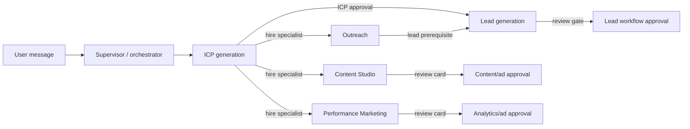

# Orchestrator Multi-Message QA Report

> Current implementation review: see **Follow-up remediation and acceptance — 2026-09-22** at the end. The original run below is historical evidence, not the current defect list. Provider-success acceptance is still separate from local implementation/testing.

**Run date:** 2026-09-20\
**Scope:** Campaign Conversation Builder / Mastra orchestrator\
**Environment:** Isolated local API on `http://localhost:8090` and frontend on `http://localhost:3000`\
**Test account:** Synthetic `performance-marketing-e2e` account (user id `24`)\
**Side-effect policy:** No lead scraping, outreach delivery, social publishing, ad publishing, pausing, or spend was authorized or executed.

## Executive result

The multi-message conversation architecture works for the primary campaign path:

The core route and state persistence survived multiple turns, specialist handoffs, ICP approval, read-only queries, and review-card creation. The run found four actionable issues and two workflow observations:

1. **Lead-input generation failed live** with an `LLMProviderResponseError` after workflow discovery succeeded. This blocks the lead-search preparation step.
2. **Content Studio sometimes reported that successful read-only tool results could not be verified**, even though the tools returned successfully.
3. **A text-only content request produced a review form with `auto_generate_image: true`**, which does not faithfully preserve the user’s “text only” constraint if the card is later confirmed.
4. **One supervisor first-turn response was returned with empty HTTP `response.content` while the correct assistant message was persisted.** A later reproduction of the same path passed, so this is intermittent rather than consistently reproducible.
5. Performance allowed two separate review cards to remain active while switching domains. This was safe in the test, but the user-facing state can be confusing.
6. The first UI attempt used `127.0.0.1` against a frontend configured for `localhost`, causing a test-origin CORS failure. Retesting with the configured host passed; this was test setup, not counted as a product defect.

The Next.js development server also emitted a Turbopack HMR panic while compiling an unrelated dashboard endpoint during the UI run. The tested conversation page still loaded and completed both messages; this is recorded as environment noise, not as an orchestrator failure.

## Inventory covered

The authoritative campaign `AgentType` union contains seven entries, and all seven were covered either live in the multi-message run or through the runtime contract suite:

| Agent | Live multi-message coverage | Result |
|---|---|---|
| `orchestrator` | Entry routing, specialist choices, registry coverage | Pass with intermittent first-turn response issue noted below |
| `supervisor` | Agent introduction and ICP-question routing | Pass |
| `icp_generation` | Minimum-details turn, ICP generation, approval continuation | Pass |
| `lead_generation` | Workflow catalog, search preparation, recovery after provider failure | Partial; provider failure |
| `content_studio` | Toolkit/profile reads, social-post review card, saved-content query | Partial; grounding and default-setting issues |
| `outreach` | Missing-leads prerequisite and no-send safety gate | Pass for guarded path |
| `performance_marketing` | Analytics review card, ad-copy review card, no-publish confirmation | Pass for guarded path |

The live test also exercised the UI composer itself with two sequential messages in one browser thread. Both assistant replies appeared in the rendered conversation and no browser console errors were reported.

## Toolkit registry coverage

The runtime registry contains **53 tools**, all of which are assigned to at least one of the seven campaign agents and all mapped tools have metadata. The mapping contains shared capabilities, so the assignment count is larger than 53.

| Agent/toolkit surface | Runtime tool assignments |
|---|---:|
| Orchestrator | 8 |
| Supervisor | 2 |
| ICP generation | 5 |
| Lead generation | 13 |
| Content Studio | 25 |
| Outreach | 19 |
| Performance Marketing | 14 |
| **Unique registered tools** | **53** |

The registry contains eight approval-gated tools:

`execute_lead_workflow`, `send_outreach_messages`, `publish_meta_ads`, `publish_ads`, `publish_google_ads`, `publish_social_post`, `stop_ads`, and `send_proposal`.

Contract and mapping coverage passed:

- 27 targeted server suites, **257 tests passed**.
- A focused tool/data/integration run, **7 suites and 253 tests passed**.
- Runtime contract checks confirmed specialist runtime tools match `agentToolMapping`, every mapping is authorized by `toolMetadata`, and ICP provider tool names match the ICP mapping.

The contract tests validate registry shape, mapping, schemas, approval flags, and selection logic. The live conversation tests below validate actual multi-turn routing and tool-loop behavior.

## Multi-message test sequences

### Sequence A — Supervisor → ICP

**Thread:** `212`\
**Purpose:** Verify that the initial coordinator turn does not require a one-shot prompt, that a follow-up can enter ICP mode, and that the generated ICP can be approved before specialist selection.

Messages sent in order:

1. “We are running a safe orchestrator QA. Do not create, execute, send, publish, pause, or spend anything. In one concise reply, list the available campaign agents and what each one handles.”
2. “Continue the same QA conversation. Focus only on the ICP agent: ask me for the minimum business details needed to define an ICP, and do not call any external or side-effecting tool yet.”
3. Supplied company, audience, geography, goal, and channels.
4. “Review the previous result and tell me what the next gate is. Do not run lead scraping, outreach, content publishing, ad publishing, or any provider action.”

Observed:

- Turn 2 entered `icp_generation` and asked for the minimum business details.
- Turn 3 called `generate_icp`, persisted an ICP revision, returned a fit score, and left the ICP unapproved.
- Turn 4 correctly explained that the next gate was approval of the exact ICP revision.
- `APPROVE_ICP` moved the state to specialist selection and returned Lead Generation, Content Studio, and Performance Marketing choices.

**Result:** Pass.

### Sequence B — Lead Generation

**Thread:** `212`, after ICP approval.

Messages/actions sent in order:

1. `HIRE_LEAD_GEN`.
2. “Continue the lead-generation QA. Show the real available workflows for LinkedIn and Google Maps. Do not execute any lead workflow and do not send anything.”
3. “Use the best recommended LinkedIn workflow for 3 B2B SaaS revenue leaders in the United States. Prepare the exact search settings only; do not execute the search.”
4. “Review the search settings you prepared and tell me whether execution is waiting for approval. Do not execute it.”

Observed:

- `list_available_workflows` worked and recommended the LinkedIn Company Search workflow.
- The catalog response included real workflow names and IDs for LinkedIn and Google Maps.
- The `generate_lead_inputs` step failed with:

  > I couldn't complete that request because the AI service could not process it. Please try again.

- The persisted state correctly showed no lead workflow execution and no pending execution approval.
- The final follow-up recovered safely and explained that no search settings had been prepared.

**Result:** Partial / failed at search-settings generation.

#### Finding L1 — provider failure in `generate_lead_inputs`

**Severity:** High for lead-generation usability; no external side effect occurred.\
**Expected:** The selected workflow should be converted into exact search settings and held for review.\
**Actual:** The provider returned an `LLMProviderResponseError`; the workflow outcome was `failed`, and the conversation could not reach the execution review gate.\
**Reasoning:** Discovery and ranking succeeded, so routing and catalog tools were healthy. The failure is isolated to the provider-backed parameter-generation step or its response parsing/handling.\
**Recommended fix:** Add provider retry/fallback for this tool, preserve a structured error code and retry affordance, and add an integration test that asserts recovery from a provider response failure.

### Sequence C — Content Studio

**Thread:** `212`, after the lead-generation failure.

Messages/actions sent in order:

1. `HIRE_CONTENT_STUDIO`.
2. “Start a Content Studio QA. First inspect the available brand toolkit and business profile for this account. Do not generate media, publish content, or call any side-effecting tool yet.”
3. “Use the default brand context and draft a concise LinkedIn launch post for Growth Lab QA, a B2B SaaS analytics product for revenue teams. Save it as a draft only; do not publish it.”
4. “Revise the saved draft to be more concise and list the saved asset. Keep it unpublished and do not call any publish tool.”

Observed:

- The brand and business context tools returned successfully: `get_brandtoolkits`, `get_businessprofiles`, `get_brandtoolkit`, and `get_businessprofile`.
- The first response nevertheless said it could not verify the action claims and did not summarize the successful read-only results.
- `generate_social_media_post` created a review widget and did not publish content.
- The saved-content query completed without creating a duplicate widget.
- The revision response again displayed the generic verification warning instead of a useful saved-asset summary.

#### Finding C1 — false-negative response grounding

**Severity:** Medium.\
**Expected:** After successful read-only receipts, the assistant should summarize the retrieved toolkit/profile or saved asset.\
**Actual:** The assistant said: “I could not verify the action claims…” despite successful read-only tool results.\
**Reasoning:** The safety layer is conservative, but it is too conservative for non-side-effecting queries and makes the agent appear unreliable.\
**Recommended fix:** Teach the grounding layer to accept successful read-only receipts as sufficient evidence for read-only claims, while keeping the stricter receipt requirement for send/publish/spend claims.

#### Finding C2 — text-only constraint not preserved in review settings

**Severity:** Medium.\
**Expected:** A text-only draft request should create a review card with image/video generation disabled.\
**Actual:** The persisted widget form for `generate_social_media_post` contained `auto_generate_image: true`, even though no image was generated because the widget was not confirmed.\
**Reasoning:** The current review card can lead to an unintended media-generation action if the user confirms without noticing the default.\
**Recommended fix:** Explicitly set `auto_generate_image: false` and `auto_generate_video: false` when the conversation contains a text-only/no-media constraint, and display those settings prominently in the review card.

### Sequence D — Performance Marketing

**Thread:** `215`.

Messages/actions sent in order:

1. Asked Sarah for read-only performance QA with no publishing, pausing, or spending.
2. Supplied business details and requested analysis only.
3. Approved the generated ICP revision.
4. `HIRE_PERFORMANCE`.
5. “Read-only QA turn: analyze the saved campaign performance… Do not publish, pause, activate, or spend.”
6. “Prepare three ad-copy variations for the same product for review only. Do not publish or launch any campaign.”
7. “Confirm which action is waiting for review, if any. Do not execute it.”

Observed:

- The agent prepared an analytics review card without running a provider mutation.
- The ad-copy turn switched to the content/tool path and created a separate ad-copy review card using `select_brand_toolkit` and `generate_ad`.
- The final turn listed both pending review cards, including their widget IDs and settings.
- The response clearly stated that no action had executed.

**Result:** Pass for read-only/review-gated behavior.

### Sequence E — Outreach

**Thread:** `212`, after a Content Studio review widget was still active.

Messages/actions sent in order:

1. `HIRE_OUTREACH`.
2. “Continue the Outreach agent QA. I want to prepare outreach, but do not send emails, DMs, proposals, or publish anything. Explain exactly what prerequisite is missing and what the review gate would be.”
3. “Check whether any existing leads are linked to this conversation. Read-only only; do not select recipients or create a send review.”
4. “Confirm that no outreach has been sent and no send action is pending. Do not execute anything.”

Observed:

- While the Content Studio widget was active, the immediate hire response repeated the pending-content review card rather than explaining the Outreach handoff.
- On the next turn, Outreach correctly detected that no leads existed and offered the safe prerequisites: hire Lead Agent, upload a CSV, or add leads manually.
- The next two turns repeated the prerequisite gate and did not call `send_outreach_messages`.

**Result:** Pass for the guarded/no-leads path.

### Sequence F — Browser/UI multi-message smoke test

**Thread:** `217`.

Messages sent through the actual frontend composer:

1. “UI QA turn one: list the available campaign agents only; do not execute any tool or side effect.”
2. “UI QA turn two: continue this same conversation and ask me for the minimum business details needed for an ICP; do not call any external tool.”

Observed:

- Both user messages and both assistant replies rendered in the same thread.
- The first assistant reply listed the campaign specialists.
- The second assistant reply asked for industry, target roles, goal, and region.
- No browser console or page errors were reported after using the configured `localhost` origin.

**Result:** Pass.

## Intermittent transport finding

### Finding T1 — first supervisor response content mismatch

**Severity:** Medium until reproduced consistently.\
**Observed:** On one initial supervisor turn, the HTTP wrapper returned an empty `response.content`, while the corresponding assistant message was persisted in the thread with the correct coordinator response.\
**Reproduction:** A later raw API run on a fresh thread returned the expected populated `response.content`, and the browser UI run also displayed the response correctly.\
**Reasoning:** This may be a response-shape/race condition in the direct-message wrapper rather than a routing failure. It is still important because API clients may treat the empty field as a failed turn even though the database contains a reply.\
**Recommended fix:** Add an integration assertion that the HTTP response content and persisted assistant content are identical for the first turn; investigate the response assembly path around `processMessageDirect` and the message persistence/stream completion boundary.

## Workflow observations

### O1 — pending review cards can coexist across specialist domains

Performance retained an analytics review card while a later ad-copy review card was created. The system remained safe, and the final response correctly listed both cards. The behavior is acceptable if multiple independent approvals are intended, but the UI should make ownership, scope, and ordering explicit. If only one pending action is intended per conversation, the switch should be blocked or the prior card should be explicitly suspended.

### O2 — Outreach handoff is hidden by an existing Content Studio review

`HIRE_OUTREACH` did not immediately explain the switch because the active Content Studio review card took precedence. The next user turn recovered correctly. Consider returning a short combined response such as “Content review remains pending; Outreach can start after you dismiss/complete it” so the user understands why the hire action did not visibly switch agents.

## Source areas reviewed

- `server/shared/agents/state.ts` — authoritative seven-agent type union.
- `server/shared/agents/agentPersonas.ts` — agent names, roles, and hire actions.
- `server/mastra/orchestrator.ts` and `server/mastra/unifiedRouter.ts` — routing and conversation-state flow.
- `server/mastra/chatController.ts` and `server/routes/chat.routes.ts` — HTTP message/action endpoints.
- `server/mastra/agents/BaseAgent.ts` — shared agent loop, tool filtering, and response grounding.
- `server/mastra/agents/icpAgent.ts`, `leadAgent.ts`, `contentAgent.ts`, `outreachAgent.ts`, and `performanceAgent.ts` — specialist behavior.
- `server/mastra/tools/toolRegistry.ts` — 53-tool metadata and agent mapping.
- `server/mastra/utils/toolCallingLoop.ts` — provider/tool-call loop.
- `server/services/agents/ThreadService.ts` — persisted thread state and pending-widget ownership.

## Final assessment

The orchestrator is structurally sound for conversational use: follow-up messages preserve context, specialist switching works, ICP approval is enforced, and high-impact actions remain behind review/approval gates. It is not ready to be called fully reliable yet because lead-input generation can fail at the provider boundary, successful read-only tool calls can produce misleading grounding warnings, and user constraints are not always reflected in review-card defaults.

The next highest-value work is to fix `generate_lead_inputs` retry/error recovery, correct read-only response grounding, and add an automated end-to-end test that sends at least two messages per agent before asserting the final state.

## Remediation addendum — 2026-09-22

This addendum supersedes the unresolved findings in the original run.

| Finding | Remediation | Verification |
|---|---|---|
| L1 lead-input provider failure | Added configured-provider fallback, one bounded retry, a stable `LEAD_INPUT_PROVIDER_UNAVAILABLE` result, durable `needs_attention` state, and no generic executable fallback. | Provider failure/recovery and persistence tests pass. |
| C1 read-only grounding warning | Successful current-turn read-only receipts now produce a field-limited summary while send/publish/activation/spend claims remain receipt-gated. | Grounding regression suite passes. |
| C2 text-only media defaults | Latest-turn text-only/no-media constraints force text format and disable image/video prompts and generation before widget persistence. | Content constraint tests pass. |
| T1 empty HTTP response | Empty graph output now recovers the persisted assistant reply after the current user-message ID, then falls back to a safe deterministic response without duplicating messages. | Turn recovery tests pass. |
| O1 review-card ownership | Inline cards show the owning agent, review ID, local status, and destination link. | Client widget contract tests pass. |
| O2 hidden Outreach handoff | Explicit recipient campaign requests route to Outreach even with a no-send constraint, and an unrelated active Content card is preserved rather than taking ownership. | Semantic router and orchestrator-state tests pass. |

Automated multi-message acceptance now sends two sequential turns through every specialist (`icp_generation`, `lead_generation`, `content_studio`, `outreach`, and `performance_marketing`), exercises two coordinator turns for `orchestrator`/`supervisor`, and asserts that every registered toolkit is assigned to an authorized agent surface.

Focused verification result: **21 suites passed, 188 tests passed, 8 database-dependent tests skipped**. Client review/analytics/widget verification: **5 suites passed, 32 tests passed**, and client type-check passed. No external scraping, send, publish, activation, pause, or spend was performed.

## Follow-up remediation and acceptance — 2026-09-22

### Case-by-case disposition

| Case | Fix / current behavior | Regression evidence |
|---|---|---|
| L1 — lead settings fail at the provider boundary | Configured-provider fallback and bounded retry preserve the selected strategy and user constraints. Failed generation does not create executable fallback inputs; retry remains preparation-only. | `leadInputGenerationPersistence`, `toolCallingLoopProviderFallback`, `leadRequestConstraints`, `leadRetryAction` |
| C1 — valid read results produce a generic warning | Grounding uses successful current-turn read receipts and field-limited summaries; completion, sending and publishing still require matching receipts. | `responseGrounding` |
| C2 — text-only is lost on revision | Social/ad constraints are applied before review persistence. Same-task follow-ups inherit the reviewed defaults; explicit later changes take precedence. New tasks must not inherit unrelated old constraints. | `contentRequestConstraints`, `adRequestConstraints`, content/ad lifecycle suites |
| T1 — empty HTTP reply despite a persisted response | Recovery selects a persisted assistant message after the current user-message boundary, avoids stale replies and duplicate persistence. | `turnResponseRecovery` |
| O1 — multiple reviews are confusing | Review ID, exact tool, owner, channel and lifecycle remain visible. Destination links open the appropriate workspace. | `widgetDestination`, `widgetReviewSurface`, `conversationActionResolution` |
| O2 — handoff hidden or falsely reported | Direct switch requests use `targetAgent`, validate the real specialist IDs, hold the thread mutex, persist pipeline state, and report the actual resulting agent. Existing draft cards survive. An unresolved execution approval returns a clear conflict instead of claiming success. | `agentSwitchRequestContract`, `directAgentSwitch`, `orchestratorSemanticState` |
| R1 — negative safety instruction accidentally triggers outreach | Routing does not treat “write a post; do not send email to leads” as outreach. Explanations stay read-only; explicit recipient preparation can correct a single-agent misroute. Multi-specialist pipelines are preserved. | `semanticRouterRegression` |
| R2 — questions blocked by missing recipients | Outreach questions can query eligible leads/campaign status even before recipient selection. Mutating tools remain removed on question turns; new outreach preparation still requires recipients. | `outreachReadOnlyAgent` (two sequential agent turns) |
| U1 — no explicit specialist picker | Shared `@` handles and aliases drive an accessible composer picker and server routing. Selecting a specialist is not an approval or execution. | `chatInputArea`, `semanticRouterRegression`; real Google Chrome check below |
| S1 — unrelated campaigns inflate sent counts | Chat reads exact owned conversation/review IDs. Delivery projection correlates campaign/job/provider IDs, ignores unrelated recipient history, distinguishes queued/sent/delivered/failed/cancelled/unavailable, and never treats missing evidence as zero sends. | `campaignActionStatus`, `campaignActionDelivery` |
| S2 — legacy lead approval hidden by an empty widget list | Status also reads fresh conversation metadata inside the owned-thread lock and lists the separate pending execution approval. It exposes only validated tool/request/owner identifiers, not approval arguments. Malformed or failed reads report unavailable. | `campaignActionStatus`, `campaignActionStatusController` |

### Conversation flow after remediation

1. An authenticated message belongs to one owned conversation. An explicit leading `@` can address a specialist; otherwise the router selects a specialist or ordered team.
2. Questions use read-only tools. Preparation respects ICP, recipient, selected-workflow, saved-asset and campaign identity requirements.
3. Review cards persist exact editable inputs. Follow-ups revise the appropriate task; unrelated review cards remain separately identified.
4. Explicit approval goes through the canonical executor and provider/account/policy preflight. A draft, a widget success, or an agent mention is not permission to send/publish/spend.
5. Workers and provider receipts establish execution results. Chat and workspace views distinguish stored states from live provider verification.

### Google Chrome check

In conversation `223`, the current composer displayed “Ask the team or use @ to choose an agent…”. Typing `@` showed Coordinator, ICP, Marcus, Alex, Emily and Sarah. Typing `emi` and pressing Enter selected `@emily ` without submitting a message. The draft was cleared and Send became disabled. This is actual Chrome UI evidence, not an in-app browser or a component mock.

A subsequent read-only status message was attempted, but the local API and frontend processes were terminated during the broader test run. There is no completed browser-response assertion for that message; do not count it as a pass. The controller path has separate automated coverage.

The browser-control transport was closed on the final retry, preventing a fresh browser status-response assertion. This does not invalidate the earlier verified picker interaction, but the status changes are signed off by controller/ledger regression tests rather than a completed Chrome exchange.

### Verification boundary

The multi-message acceptance suite exercises coordinator/specialist routing with a mocked model decision. Registry coverage verifies every tool assignment, not successful live execution of every external integration. Executor, worker, widget and provider-failure suites provide the additional layered evidence. Live provider success, paid Yelp extraction, and scheduled dispatch at a future time remain unverified in this run. No external send, publish, activation or spend was performed.

### Follow-up verification results

- Supported runtime: Node **24.19.0**; Jest run serially (`--runInBand`).
- Combined campaign/server acceptance: **42 suites, 598 tests passed**. Includes all cases named in the disposition table, real HTTP status-handler tests, registry/runtime-tool contracts, and approval/executor lifecycle tests.
- Additional compaction/state and BaseAgent checks: **2 suites, 14 tests passed**.
- Full client regression: **180 test files, 1,311 tests passed** (`pnpm test --maxWorkers=1 --testTimeout=30000`). Single-worker execution and a 30-second per-test timeout avoided the initial resource-contention timeout failures; this run finished successfully.
- Final named-campaign selection regression: **16 tests passed**. A newly named campaign no longer inherits an older numeric campaign ID/platform; same-campaign revisions still preserve their selection.
- Final status/approval-ledger rerun: **3 suites, 104 tests passed**, including real handler integration after the separate legacy approval read was wired in.
- Final combined campaign-identity/tool-loop/compaction rerun: **3 suites, 54 tests passed**. Server typecheck passed again after these last edits. Rerun counts overlap the earlier combined acceptance run and are not additional unique test totals.
- Server and client TypeScript checks passed. The first client attempt encountered malformed generated `.next/dev/types` files; `next typegen` regenerated them, then the check passed without changing application typing rules.
- PostgreSQL read-only schema inspection confirmed all **44 required columns across six tables** for the new delivery query. No schema migration is needed for it.
- `git diff --check` passed.
- An earlier broad run was terminated with exit 143 while the API/frontend also stopped; it is not counted as a passing run. The successful 42-suite rerun supersedes its campaign test attempt.

### Actual Chrome retry — 2026-09-22 afternoon

See [the detailed Chrome retry cases](MANUAL_CHROME_MULTI_MESSAGE_QA.md#chrome-retry-and-multi-message-acceptance--2026-09-22-1223-ist-onward) for exact prompts, tool/review IDs, failures, causes and retests. Chrome exercised ICP approval, the six-agent mention picker, Content revisions, Outreach readiness/recipient guards, Performance ad reviews, executed read-only analytics, lead catalogs and calendar lookup in consecutive messages.

This run found additional issues beyond the earlier automated signoff: prior-turn workflow state kept the composer busy; Content confused an unexecuted review ID with a saved asset ID; this-campaign analytics were account-wide and plotted missing measurements as zeros; a late submit acknowledgement regressed a completed widget to running; and bare `not Yelp` was ignored by catalog channel extraction. Local fixes and focused regressions were added. Composer, Content revision, scoped analytics and terminal widget state passed Chrome retests. Invalid routing output and one Gemini 503 were also observed and are documented as failures, not passes.

Final Chrome retests also passed Google Maps-only exclusion and campaign-only saved-content lookup. The latter exposed and fixed an additional account-wide listing default. Final focused server verification passed **10 suites / 103 tests**; client verification passed **4 files / 50 tests**. The latest server typecheck passed after transient concurrent-workspace errors settled.

The final client typecheck is blocked by a new unrelated concurrent test error at `client/src/__tests__/followUpActivity.test.tsx:51` (string versus channel-union type). That file was left untouched; this supersedes earlier client-typecheck success for the current shared workspace.

This is **not** full live-provider signoff. No outbound recipient contact, provider scrape, social publication, scheduled dispatch or ad activation/spend was approved. Latest verification and remaining boundaries are recorded in the detailed report.

### Semantic intent routing follow-up — 2026-09-22

See [Model-driven campaign intent routing](SEMANTIC_INTENT_ROUTING_QA.md) for removal of core natural-language regex overrides, multilingual/negation checks, model-derived review references and constraints, automated verification, and the discovered length-preservation failure with its correction and remaining browser-retest boundary. This supersedes phrase-based routing descriptions above; deterministic approval/ownership checks remain.
