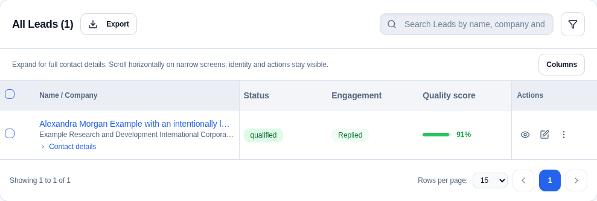
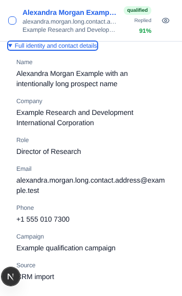

# UX003: Actionable Leads columns on v8

Branch `codex/asksales-ux003-20261009-v8` starts from fetched `origin/v8` at `09fe888ec8bdd3fa12ccee0e047cd1d876306222`. This ports the focused presentation improvement from `ef1c52376819a6ff7497ec1141290f40013e9fb2`. The original branch and commit are preserved; this branch does not merge the v7 history into v8.

UX003 remains a subjective UI/UX recommendation, not a verified data defect or a production fix. The inspected v8 page still placed contact columns before qualification signals in its wide table.

## Result

- The compact default contains selection, combined name/company, status, engagement, quality score and actions. Qualification and a primary action fit within the default table region at 1311 × 841 CSS pixels.
- Full identity, role, email, phone, campaign and source remain available through keyboard-accessible expanded details with wrapping. Identity truncation has a reveal mechanism and retains the existing lead-detail navigation.
- Optional role, email, phone, campaign and source columns can be enabled, persisted in this browser and reset. Saved values contain only presentation identifiers, never records or business data. Invalid or unavailable storage falls back safely.
- Selection and identity stay pinned on the left; primary and other row actions stay pinned on the right. The focusable scroll region explains horizontal scrolling. Expanding contact details or starting inline editing returns to the beginning to reveal full fields.
- Mobile cards retain the current personalized View control, add engagement and expose full fields through a native disclosure.
- Internal source values receive presentation labels such as `CRM import`, `CSV import` and `Manual entry`; query identifiers remain unchanged.

## v8 compatibility

Current CRM contact creation and directory navigation, business-profile scoping, filters, pagination correction, review-outreach navigation, delete confirmation and inline-save guards remain in place. The expanded editor uses the existing save handler, including Enter-to-save, disabled Save/Cancel during a request, retained fields after failure and trimmed-name retry behavior.

The API client, business-profile implementation, CRM components and request/filter handlers were not replaced. Browser fixtures verify `X-Business-Profile-Id: 4102` on mocked lead queries and updates, and verify that status, source, score, sort and search still reach the lead query. This is compatibility evidence rather than a complete tenant-security audit.

## Validation

- Vitest: 23 passing tests across `leadDirectoryColumns`, `leadDirectoryLoading`, `leadPagesLoading` and `businessProfileSwitch`, including the existing v8 failure/retry regression.
- Playwright Chromium: 7 applicable cases pass, with 3 intentional mobile skips for desktop-only workflows. Viewports: 1311 × 841, 1024 × 841 and 390 × 844. Covers long fields, full-identity reveal, focus, keyboard scrolling, pinned columns/actions, preference persistence/reset, inline updates and Enter-to-save, selection/action menu, detail navigation, current CRM entry points, business headers, filters and document overflow.
- Client typecheck passes using the v8 `tsconfig.typecheck.json` script.
- Full source lint: 1 existing error and 218 warnings. `src/__tests__/businessBillingIdentity.test.tsx:47` violates `react/display-name`; its blob hash matches `origin/v8` (`a8dfa37434c1d8a707cbae6028e54f9f08392565`), and a separate lint invocation reproduces the error. It was not changed as part of UX003. Generated `.next-ux003-v8-preview/**` is excluded through a temporary CLI argument; no committed lint configuration was changed.
- Focused lint passes with 0 errors and 0 warnings.
- Production build passes, including TypeScript, all 302 static pages and build tracing.
- `git diff --check` passes.

Browser requests, including updates, are fulfilled entirely by synthetic fixtures. Local verification uses installed `/usr/bin/chromium` through a temporary Playwright configuration and an isolated preview on port 3003; bundled browser/video binaries are unavailable, so video is disabled. Generated preview TypeScript include entries were restored rather than committed.

The full client unit suite, unrelated E2E suites, server tests, other browser engines and live-provider integrations were not run. Narrow desktop tables and enabled optional columns can still scroll; pinned identity/actions and the scroll guidance preserve discoverability there. No merge, deployment, live-record mutation or credential change was performed.

## Deployment-trigger evidence for integration

The checked repository workflows `cross-layer-regression.yml` and `support-agent-safety.yml` both restrict their push triggers to `main`; they contain test/validation jobs. `deploy.sh:44–48` explicitly publishes to and pulls `v7` when invoked. `deploy-staging.sh:13,27–33` defaults to `staging` and refuses other refs, including `v8`. Neither helper was run.

This is repository evidence only. It does not establish whether a push to `v8` triggers deployment through an external hosting or webhook configuration. Those settings were not verified. This task publishes only the isolated correction branch; merging/pushing `v8` belongs to the separate integration task.

## Synthetic screenshots

Screenshots were captured on this v8 implementation and cropped to the relevant content. They contain only synthetic contacts; the original contact-data screenshot is not published.

